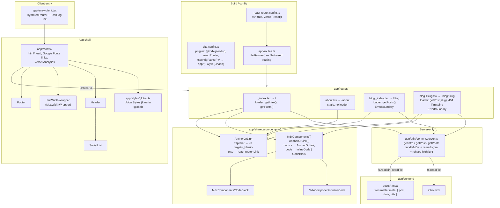
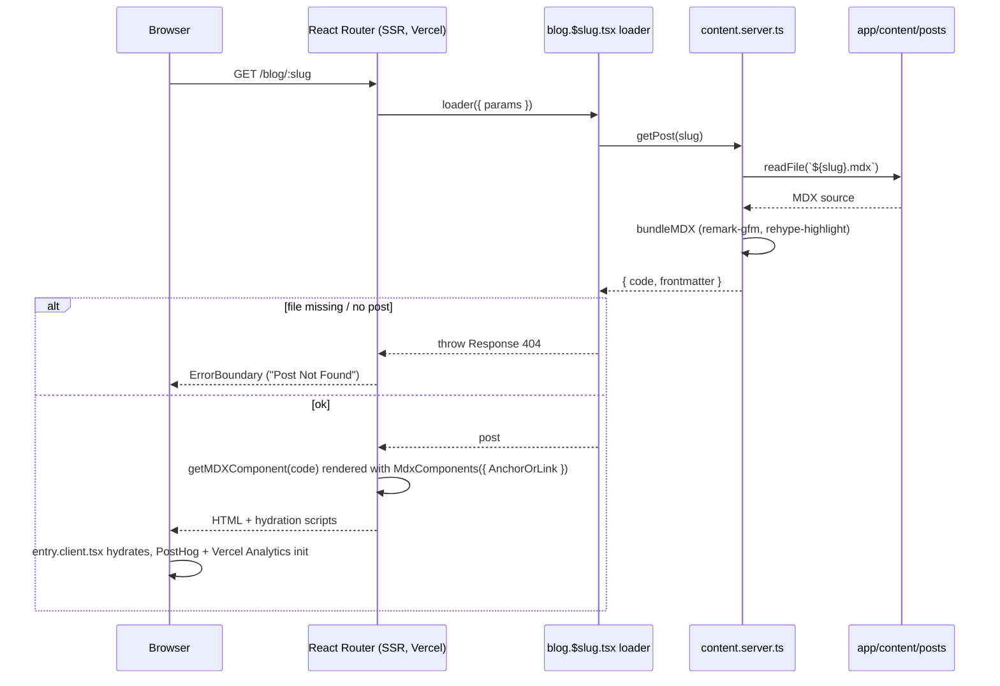

# Architecture

Personal site / blog built with React Router v7 (framework mode, SSR) on Vite,
deployed to Vercel. Content is MDX bundled at request time with `mdx-bundler`.
Styling is zero-runtime CSS via Linaria (`@linaria/react` / `@linaria/core`,
compiled by `@wyw-in-js/vite`).

## Module map

## Request flow: rendering a blog post

## Conventions and gotchas

- Adding a post: create `app/content/posts/<slug>.mdx` with frontmatter under
  `meta` (`post`, `date` as `YYYY-MM-DD`, `title`). The **filename must equal
  `meta.post`**, because `/blog` links use `meta.post` while `getPost` reads the
  file by that slug.
- `getPosts()` bundles every post on each request (no caching) and sorts by
  `meta.date` descending. Both `/` and `/blog` call it.
- View transitions: the blog list link and the post `<Title>` share a
  `viewTransitionName` derived from the title (lowercased, spaces → `-`).
- MDX is compiled at runtime via `mdx-bundler`, not by the `@mdx-js/rollup` Vite
  plugin. Images (`.png`, `.gif`) imported in MDX are inlined as data URLs.
- Any file named `*.server.ts` is server-only; don't import it from client code
  except through a route `loader`.
- All styling uses Linaria. `styled-components` is installed but not used in
  `app/`.
- Static assets (e.g. `/images/me.webp`) live in `public/`.
